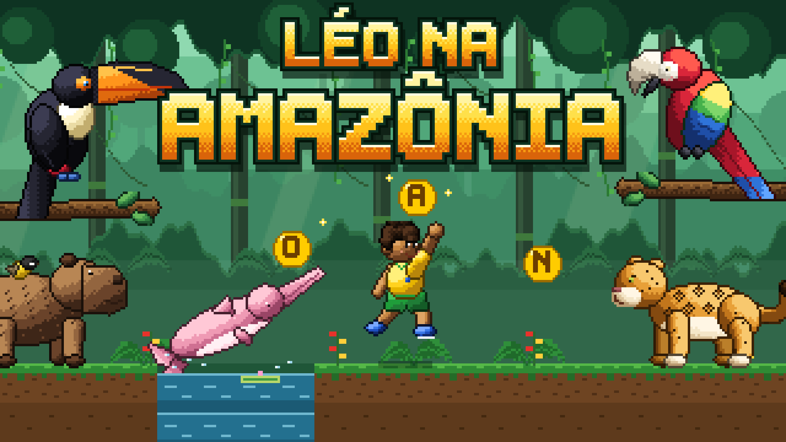
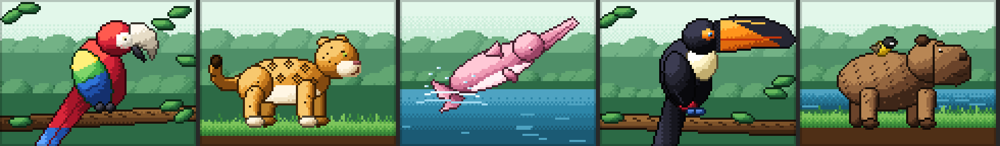

# Léo na Amazônia



Jogo de plataforma 2D educativo, em pixel art, feito na **Godot Engine 4**.
O Léo atravessa a floresta amazônica coletando letras espalhadas pelo caminho. Com elas, o jogador
**monta o nome de um animal da Amazônia** e depois responde a um desafio de **Verdadeiro ou Falso**
sobre esse animal. A proposta é treinar leitura e escrita e, ao mesmo tempo, aprender curiosidades
sobre a fauna amazônica (arara, onça-pintada, boto-cor-de-rosa, tucano e capivara).



- **Gênero:** plataforma 2D + quebra-cabeça de palavras + quiz
- **Público:** crianças em fase de alfabetização (aproximadamente 6 a 10 anos)
- **Idioma:** português
- **Documento de design (GDD):** [docs/GDD.md](docs/GDD.md)
- **Vídeo de apresentação (90 s):** [assistir / baixar](https://github.com/RicardoFissmer/leo-na-amazonia/releases/download/v1.6/leo-na-amazonia-video.mp4)
  — o Léo se apresenta e mostra o jogo. Como foi feito: [video/LEIAME.md](video/LEIAME.md)

---

## Sumário

1. [Requisitos](#1-requisitos)
2. [Como baixar o projeto](#2-como-baixar-o-projeto)
3. [Instalação e configuração do ambiente](#3-instalação-e-configuração-do-ambiente)
4. [Como executar o jogo](#4-como-executar-o-jogo)
5. [Como jogar](#5-como-jogar)
6. [Objetivo, regras e progressão](#6-objetivo-regras-e-progressão)
7. [Limitações conhecidas e o que ainda não foi feito](#7-limitações-conhecidas-e-o-que-ainda-não-foi-feito)
8. [Estrutura do projeto](#8-estrutura-do-projeto)
9. [Como modificar o jogo](#9-como-modificar-o-jogo)
10. [Créditos e licenças](#10-créditos-e-licenças)

---

## 1. Requisitos

### Para só jogar (executável pronto)

| Item | Requisito |
|---|---|
| Sistema operacional | Windows 10 ou 11, 64 bits |
| Placa de vídeo | Com suporte a Vulkan ou Direct3D 12 (praticamente qualquer computador dos últimos 8 anos) |
| Outros programas | Nenhum |

### Para abrir o projeto no Godot (código-fonte)

| Item | Requisito |
|---|---|
| Sistema operacional | Windows 10/11, Linux ou macOS (o projeto foi desenvolvido e testado no **Windows 11**) |
| Engine | **Godot Engine 4.7** ou mais nova, **versão padrão** (*não* a versão .NET/C#). Testado na **4.7.2-stable** |
| Linguagem | GDScript (vem junto com o Godot, não precisa instalar nada) |
| Git (opcional) | Qualquer versão recente, só para clonar o repositório |
| Python + Pillow (opcional) | Só para redesenhar a arte dos animais com `tools/gerar_arte.py`. **Não é necessário para jogar** |

---

## 2. Como baixar o projeto

### Opção A — Baixar o jogo pronto (Windows)

1. Abra a página **[Releases](https://github.com/RicardoFissmer/leo-na-amazonia/releases/latest)** do repositório.
2. Baixe o arquivo **`LeoNaAmazonia-windows.zip`**.
3. Descompacte o arquivo em qualquer pasta.

### Opção B — Clonar o repositório com Git

```bash
git clone https://github.com/RicardoFissmer/leo-na-amazonia.git
```

### Opção C — Baixar o código como ZIP (sem Git)

1. Na página do repositório, clique no botão verde **Code** → **Download ZIP**.
2. Descompacte o arquivo em qualquer pasta.

---

## 3. Instalação e configuração do ambiente

**Se você baixou o jogo pronto (opção A), pule para a [seção 4](#4-como-executar-o-jogo).**

Para abrir o código-fonte:

1. Baixe o Godot em <https://godotengine.org/download>. Escolha a versão **4.7 ou mais nova**, botão
   **Godot Engine** (não o "Godot Engine – .NET").
   Versões antigas ficam em <https://godotengine.org/download/archive/>.
2. Descompacte o arquivo baixado. O Godot **não precisa ser instalado**: é só um executável
   (por exemplo, `Godot_v4.7.2-stable_win64.exe`).
3. Não há outras dependências: o jogo não usa plugins, addons nem bibliotecas externas.
   Todas as imagens, sons e scripts já estão no repositório.

---

## 4. Como executar o jogo

### Pelo executável (Windows)

1. Dê dois cliques em **`LeoNaAmazonia.exe`**.
2. Se o Windows mostrar o aviso *"O Windows protegeu o computador"*, clique em **Mais informações** →
   **Executar assim mesmo**. O aviso aparece porque o executável não tem assinatura digital.

### Pelo Godot (código-fonte)

1. Abra o Godot. Vai aparecer o **Gerenciador de Projetos**.
2. Clique em **Importar** e selecione o arquivo **`project.godot`** que está na pasta do projeto.
3. Clique em **Importar e Editar**. Na primeira vez, o Godot importa as imagens e sons e cria a pasta
   `.godot/` — isso leva alguns segundos e é normal.
4. Com o editor aberto, aperte **F5** (ou clique no botão ▶ **Executar Projeto**, no canto superior direito).
   A cena principal (`scenes/main.tscn`) já está configurada.

Também é possível rodar direto pelo terminal, sem abrir o editor (troque pelo caminho do seu Godot):

```bash
Godot_v4.7.2-stable_win64.exe --path caminho/para/leo-na-amazonia
```

### Gerar o executável (opcional)

No editor: **Projeto → Exportar… → Windows Desktop → Exportar Projeto**. O arquivo é criado em `build/`.
Na primeira vez, o Godot pede para baixar os *export templates* (**Gerenciar Modelos de Exportação → Baixar e Instalar**).

Pelo terminal:

```bash
Godot_v4.7.2-stable_win64_console.exe --headless --path . --export-release "Windows Desktop" build/LeoNaAmazonia.exe
```

---

## 5. Como jogar

### Iniciando uma partida

1. Ao abrir o jogo aparece a **tela inicial**, com o logo e quatro placas de madeira:
   - **Jogar** — começa a partida (história + fase 1);
   - **Como jogar** — mostra um resumo das regras e dos controles;
   - **Modo retrô** — liga/desliga o visual de TV antiga (o mesmo da tecla R);
   - **Sair** — fecha o jogo.
2. Escolha com o **mouse** ou com as **setas ↑ ↓ + Enter**. A cabeça do Léo marca o botão selecionado.
3. Ao clicar em **Jogar**, aparece a **história** em 3 telas: o *Livro da Floresta* da vovó Lúcia perdeu as
   letras numa ventania, e o Léo vai à mata devolver o nome de cada animal.
   **Enter**, **Espaço** ou um clique passam de tela. **Esc** pula a história.
4. A fase 1 começa com o Léo à esquerda do mapa. A **dica** do animal aparece no topo da tela.

### Tutorial (fase 1)

A primeira fase ensina a jogar enquanto se joga. Uma dica de cada vez aparece num quadro no alto da tela,
na hora certa, e some quando o jogador faz o que ela pede:

1. andar (setas ou A/D);
2. pegar a moeda com letra (e ver a letra aparecer no alto da tela);
3. pular (Espaço);
4. pular o buraco;
5. passar pela onça;
6. atravessar o rio quando a piranha mergulhar (as bolhas avisam que ela vai pular);
7. passar pela cobra quando ela subir (ela treme antes de descer).

Enquanto o Léo está nessa parte inicial do mapa, **errar não tira vida**: se ele cair, volta para logo antes
do obstáculo e pode tentar de novo. Depois do último aviso ("Agora é com você!"), valem as regras normais.

### Controles

| Tecla | Onde | O que faz |
|---|---|---|
| **← →** ou **A D** | Fase | Anda para a esquerda / direita |
| **Espaço**, **↑** ou **W** | Fase | Pula. Segurar o botão faz o pulo ir mais alto; soltar cedo faz um pulo baixo |
| **Enter** | Menus e telas de desafio | Confirma / escolhe o botão selecionado / passa para a próxima tela |
| **Setas** | Menus e telas de desafio | Muda o botão selecionado |
| **Mouse (clique)** | Menus e telas de desafio | Clica nos botões, nas letras e nas respostas |
| **Backspace** | Montar a palavra | Desfaz a última letra colocada |
| **Esc** | Qualquer momento | Volta para a tela inicial (o progresso da partida é perdido) |
| **M** | Qualquer momento | Liga / desliga o som |
| **R** | Qualquer momento | Liga / desliga o **modo retrô** (linhas de TV antiga e tela curva). Também dá para mudar no menu, no botão *Modo retrô*. A escolha fica salva |

### Interface (HUD)

- **Topo à esquerda:** `LETRAS:` com as letras já coletadas e um `_` para cada letra que falta.
- **Logo abaixo:** a dica do animal.
- **Topo à direita:** os **corações** (vidas) e a **pontuação**.
- **Centro:** mensagens rápidas (letra coletada, dano, "Fase 2" etc.).

---

## 6. Objetivo, regras e progressão

### Objetivo

Descobrir e montar o nome do animal de cada fase e acertar o máximo de perguntas sobre ele,
passando pelas **5 fases**: **ARARA → ONÇA → BOTO → TUCANO → CAPIVARA**.

### Cada fase tem três etapas

**1. Coletar as letras (plataforma)**
- As letras da palavra estão em moedas espalhadas pelo mapa, **fora de ordem**.
- Também existem **letras erradas** (que não fazem parte da palavra), para confundir.
- Use a **dica** do topo da tela para descobrir qual é o animal.

**2. Montar a palavra**
- Quando todas as letras certas forem coletadas, aparece a imagem do animal e as letras embaralhadas.
- Clique nas letras (ou use setas + Enter) **na ordem certa** para formar o nome.
- Se errar, as letras que estão na posição certa ficam **verdes e travadas** e as outras voltam.
- Ao acertar, aparece uma **curiosidade** sobre o animal.

**3. Verdadeiro ou Falso**
- Aparecem **3 afirmações** sobre o animal (sorteadas entre 5, sempre com pelo menos uma verdadeira e uma falsa).
- Para cada uma, escolha **VERDADEIRO** ou **FALSO**. Certo ou errado, o jogo mostra uma explicação.
- No fim aparece quantas você acertou. Aperte **Enter** para ir à próxima fase.

### Perigos

| Perigo | Comportamento | Dica |
|---|---|---|
| **Onça-pintada** | Anda de um lado para o outro no chão | Pule por cima dela |
| **Cobra** | Fica escondida embaixo de um tronco, **treme** (aviso) e desce até a altura do Léo | Passe quando ela estiver escondida |
| **Piranha** | Mora no rio. Quando aparecem **bolhas**, ela pula para fora da água | Atravesse o rio logo depois que ela mergulhar |
| **Rio e buracos** | Cair neles faz o Léo voltar para o começo da fase | — |

### Vidas, vitória e derrota

- O Léo tem **3 vidas** (corações) em cada fase.
- Encostar na onça, na cobra ou na piranha **tira 1 vida**. O Léo é empurrado e fica piscando por um
  instante, sem levar dano.
- Cair no rio ou num buraco **tira 1 vida** e o Léo volta para o início da fase.
- **Derrota:** ao perder as 3 vidas, a fase **recomeça do zero** (as letras voltam para o mapa). Não existe "game over".
- **Progressão:** completar as três etapas de uma fase libera a próxima.
- **Vitória:** completar as 5 fases. Aparece a mensagem *"Você completou todas as palavras!"* e o jogo volta para a tela inicial.

### Pontuação

| Ação | Pontos |
|---|---|
| Pegar uma letra da palavra | +10 |
| Pegar uma letra errada | −5 (a pontuação nunca fica negativa) |
| Montar a palavra na 1ª tentativa | +50 |
| … na 2ª / 3ª / 4ª tentativa ou mais | +35 / +20 / +10 |
| Cada resposta certa no Verdadeiro ou Falso | +20 |

---

## 7. Limitações conhecidas e o que ainda não foi feito

### Limitações da versão atual

- **O tutorial só ensina o movimento e os perigos.** A montagem da palavra e o Verdadeiro ou Falso são explicados
  pelo texto da própria tela, sem passo a passo.
- **Todas as fases usam o mesmo mapa.** O que muda é a palavra, a ordem das letras e as letras erradas.
- **Não há salvamento.** Ao fechar o jogo ou apertar Esc, a partida e a pontuação são perdidas.
  Também não há recorde nem ranking.
- **Não há menu de pausa.** Esc volta direto para a tela inicial.
- **Os pontos não são descontados quando a fase recomeça.** Ao perder as 3 vidas, as letras voltam e
  podem ser coletadas de novo, somando +10 outra vez (falha conhecida).
- **Controles só por teclado e mouse.** Não há suporte a controle (gamepad) nem a tela de toque.
- **Executável só para Windows.** No Linux e no macOS, o jogo roda pelo Godot (código-fonte), mas não há executável pronto.
- **Só em português.** Não há opção de idioma.
- **Som:** só dá para ligar ou desligar (tecla M). Não há controle de volume.
- O executável **não tem assinatura digital**, então o Windows pode mostrar um aviso na primeira vez.

### Funcionalidades planejadas e ainda não implementadas

- Testes com crianças do público-alvo e ajustes a partir do que for observado.
- Controle de volume e opção de texto maior.
- Um mapa diferente para cada animal, com dificuldade crescente.
- Novos tipos de desafio: **"Quem sou eu?"** (silhueta do animal) e **"Letra que falta"**.
- *Checkpoint* no meio da fase.
- Narração em áudio das palavras e curiosidades, para quem ainda está aprendendo a ler.
- Salvar o recorde e mostrar um álbum dos animais descobertos.
- Suporte a gamepad e a celular.

---

## 8. Estrutura do projeto

```
project.godot        configuração do projeto Godot (resolução, cena principal etc.)
export_presets.cfg   configuração para gerar o executável do Windows
scenes/main.tscn     cena principal (todo o resto é criado por código)
scripts/
  main.gd              regras do jogo, palavras, perguntas e o MAPA da fase
  titulo.gd            tela inicial (Jogar, Como jogar, Sair)
  montagem.gd          tela de montar a palavra
  verdadeiro_falso.gd  desafio de Verdadeiro ou Falso
  historia.gd          telas da história (começo e fim do jogo)
  tutorial.gd          dicas do tutorial da fase 1
  efeitos.gd           efeitos de tela: vinheta/cor, transição pixelada e modo retrô
shaders/             shaders dos efeitos (ambiente.gdshader e tela.gdshader)
shaders/vesperafx/   módulos do VesperaFX usados pelos shaders (licença MPL-2.0)
  hud.gd               letras, dica, vidas, pontos e mensagens
  player.gd            movimento e pulo do Léo
  letra.gd             letra coletável
  onca.gd              onça que patrulha o chão
  cobra.gd             cobra que desce do tronco
  piranha.gd           piranha que pula do rio
  arara.gd             araras voando no céu (enfeite)
  audio.gd             música e efeitos sonoros
  util.gd              funções de apoio
assets/              imagens em pixel art (personagens, cenário, inimigos)
assets/animais/      imagens dos animais (96×72) das telas de desafio
assets/historia/     imagens das telas da história (96×72)
sons/                música (musica.ogg) e efeitos sonoros (.wav)
docs/GDD.md          documento de design do jogo
capa/                capa do jogo (1920x1080, 1280x640 e 320x180)
video/               vídeo de apresentação (roteiro, projeto Remotion, trilha) — ver video/LEIAME.md
tools/               geradores de arte em Python (Léo, retrato, menu, animais, história, capa) e prévias
```

---

## 9. Como modificar o jogo

- **Novas palavras/fases:** edite a lista `PALAVRAS` no começo de `scripts/main.gd` (até 8 letras) e coloque
  uma imagem 96×72 em `assets/animais/`.
- **Perguntas do Verdadeiro ou Falso:** em cada palavra de `PALAVRAS`, adicione itens em `"perguntas"` no
  formato `["afirmação", true ou false, "explicação"]`.
- **Mudar o mapa:** edite o `MAPA` em `scripts/main.gd`. Cada caractere é um bloco de 16×16 pixels:
  `#` chão, `~` água, `=` plataforma, `P` início do Léo, `O` onça, `C` cobra (embaixo de um `=`),
  `F` piranha (em cima de um `~`), `1`–`8` letras da palavra, `x` letra errada, `.` vazio.
- **Pulo e velocidade:** constantes no topo de `scripts/player.gd`.
- **Sons:** substitua os arquivos em `sons/` mantendo os mesmos nomes. O volume fica em `scripts/audio.gd`.
- **Arte dos animais e inimigos:** instale o Pillow (`py -m pip install pillow`), ajuste `tools/gerar_arte.py`
  e rode `py tools/gerar_arte.py` na pasta do projeto.
- **História:** o texto das telas fica em `HISTORIA_INICIO` e `HISTORIA_FIM`, no começo de `scripts/main.gd`.
  As imagens são geradas por `py tools/gerar_historia.py`.
- **Dicas do tutorial:** a lista `PASSOS` no começo de `scripts/tutorial.gd` diz em que coluna do mapa cada dica
  aparece e o que o jogador precisa fazer para ela sumir.
- **Léo:** o sprite (16×24, 13 quadros) é desenhado por `py tools/gerar_leo.py`; o retrato grande do vídeo,
  por `py tools/gerar_retrato.py`. As imagens do menu (logo, placas, cursor) vêm de `py tools/gerar_ui.py`.
- **Capa:** rode `py tools/gerar_capa.py` (usa as mesmas imagens do jogo; regrava os arquivos em `capa/`).
- **Efeitos de tela:** a intensidade da vinheta, da cor, das linhas do modo retrô e a duração da transição ficam
  no começo de `scripts/efeitos.gd`.

---

## 10. Créditos e licenças

- **Efeitos de tela:** módulos do [VesperaFX](https://github.com/devkcud/VesperaFX), de **devkcud**, sob a
  [Mozilla Public License 2.0](shaders/vesperafx/LICENSE.txt). Usamos `crt`, `pixelation`, `rendering` e `utils`
  sem modificação (detalhes em [shaders/vesperafx/LEIAME.md](shaders/vesperafx/LEIAME.md)).
- **Engine:** [Godot Engine](https://godotengine.org) (licença MIT), com a fonte padrão do Godot.
